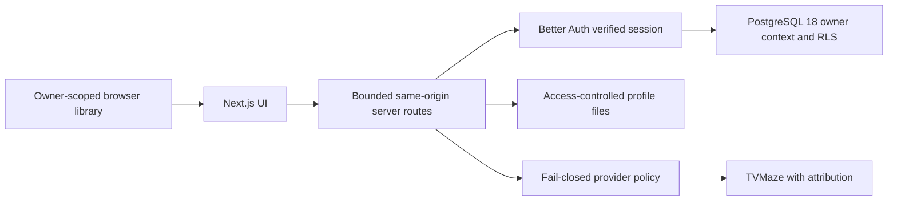

# MediaTracker v1 — portfolio kit / portfolyo paketi

Prepared 2026-10-15. Publishing to ArtifactHub, LinkedIn or a CV is a separate user
action; this document prepares copy only. Do not claim legal compliance, always-on
AI, enabled TMDB/AniList, zero downtime or full real-backup restore acceptance.

## Architecture / mimari

MediaTracker is a local-first Next.js App Router application. Owner-scoped browser
storage is the local library authority. Optional Cloud Sync uses revision,
idempotency, tombstone and conflict contracts. Production v1 uses native PostgreSQL
18, Better Auth and Node.js under Plesk/Passenger; the Supabase adapter is retained
as a separate supported path. Server-verified sessions determine user identity;
transaction-local owner context and FORCE RLS constrain business data. Passwords
are hashed, verified email is required, and reset/revocation is tested separately
from SMTP delivery. No deployment topology is inferred from CI alone.

Deterministic Recommendation V2 owns eligibility and final ranking. Paid AI,
grounded research and persistent embedding caching remain disabled for v1. Provider
adapters in source are not evidence that their live APIs are enabled.

## Five-minute demo / beş dakikalık demo

Use a disposable local browser profile with synthetic data, disabled outbound mail,
no real account cookie or copied Production database. Guest/manual flows suffice;
use isolated synthetic accounts only when demonstrating optional Cloud.

1. **0:00–0:45** — explain local-first ownership; manually add a fictional series
   and book without any provider key or remote API request.
2. **0:45–1:45** — update progress/rating/notes; show consistent library/dashboard
   state and filtering. Do not present mock data as live user activity.
3. **1:45–2:30** — create a goal and a manual calendar event; distinguish local
   calendar navigation from provider release horizon.
4. **2:30–3:15** — show library-only deterministic recommendations and describe
   eligibility/ranking. Do not run or advertise an AI-generated ranking.
5. **3:15–4:15** — explain optional Cloud's owner isolation/revision conflicts with
   synthetic fixtures or a diagram. Show export with fictional notes only; clarify
   portable export is not full account export or server backup.
6. **4:15–5:00** — settings/accessibility, provider attribution, privacy link and
   deliberate disabled-provider policy; finish with exact test/CI links, labeled
   source, synthetic, CI or operator-reported evidence.

## Screenshot plan / ekran görüntüsü planı

| Shot | Content | Capture constraints |
| --- | --- | --- |
| 01-library | Desktop library with 3–5 fictional manual items | No copyrighted provider covers; no real names/email |
| 02-progress | One synthetic progress update and dashboard | Fixed fictional values, no production statistics |
| 03-goals-calendar | Goal and manual event | No personal routines/notes |
| 04-recommendations | Library-only deterministic result | Label mode accurately; no model/embedding claims |
| 05-settings | Theme, privacy and attribution area | Show official logo unchanged only from PR #1; keep required notice/source link visible |
| 06-mobile | Narrow library and navigation | Check long labels, focus/contrast and no horizontal clipping |
| 07-architecture-ci | Diagram and exact CI run | Redact private paths, account names, logs, tokens and infrastructure details |

Capture after the candidate is available in an authorized local preview. Screenshots
are planned, not captured in this closure; do not fabricate UI or stage real user
data. Keep provider branding unchanged and comply with source/image permissions.

## ArtifactHub description

**TR:** MediaTracker; dizi, film, kitap ve diğer medya kayıtlarını tek kütüphanede
takip etmek için geliştirdiğim yerel öncelikli web uygulaması. İlerleme, hedef,
takvim ve deterministik önerileri; isteğe bağlı hesap kapsamlı Cloud Sync ile
birleştiriyor. Production v1 mimarisi Next.js, PostgreSQL 18, Better Auth ve
Plesk/Passenger üzerine kurulu. Owner izolasyonu, revizyon/idempotency sözleşmeleri,
RLS ve sağlayıcı politikaları testlerle ele alındı. TMDB ve AniList canlı erişimi
kapalı; ücretli AI kullanımı v1 kapsamına alınmadı.

**EN:** MediaTracker is a local-first web application I built to track series,
films, books and other media in one library. It combines progress tracking, goals,
a calendar and deterministic recommendations with optional account-scoped Cloud
Sync. Production v1 uses Next.js, PostgreSQL 18, Better Auth and Plesk/Passenger.
Tests cover owner isolation, revision/idempotency contracts, RLS and provider
policy boundaries. Live TMDB and AniList access remain disabled; paid AI is outside
the v1 scope.

## CV

**TR:** Next.js ve PostgreSQL 18 tabanlı yerel öncelikli MediaTracker uygulamasını
geliştirdim; Better Auth, owner-scoped Cloud Sync, RLS ve deterministik öneri
sözleşmelerini regresyon testleri ve GitHub Actions doğrulamasıyla destekledim.

**EN:** Built MediaTracker with Next.js and PostgreSQL 18, implementing local-first
tracking, Better Auth, owner-scoped Cloud Sync, RLS and deterministic recommendation
contracts backed by regression tests and GitHub Actions validation.

## LinkedIn

**TR:** MediaTracker v1 üzerinde yalnız özellik geliştirmeye değil, veri sahipliği
ve sürüm güvenliğine de odaklandım. Yerel kütüphane ve isteğe bağlı Cloud Sync;
PostgreSQL 18, Better Auth ve Plesk/Passenger mimarisiyle bir araya geldi. En çok
çalıştığım konular owner izolasyonu, eşitleme çakışmaları, oturum güvenliği ve
sağlayıcı izin sınırlarıydı. Deterministik öneriler aktif; izin ve veri yaşam döngüsü
tamamlanmayan sağlayıcılar bilinçli olarak kapalı tutuluyor.

**EN:** While building MediaTracker v1, I focused on data ownership and release
safety alongside features. A local library and optional Cloud Sync run on a
Next.js, PostgreSQL 18, Better Auth and Plesk/Passenger architecture. My main work
covered owner isolation, sync conflicts, session security and provider permission
boundaries. Recommendations are deterministic, and providers with unresolved
permission or data-lifecycle requirements remain deliberately disabled.

Product: https://mediatracker.baglare.com.tr — repository:
https://github.com/Baglare/MediaTracker. Link the final accepted PR/CI evidence when
publishing; the presence of this draft does not mean a new version was deployed.
